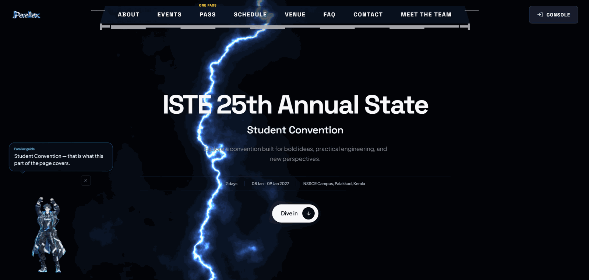
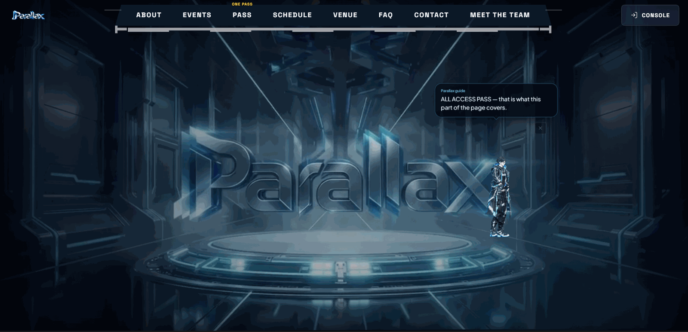
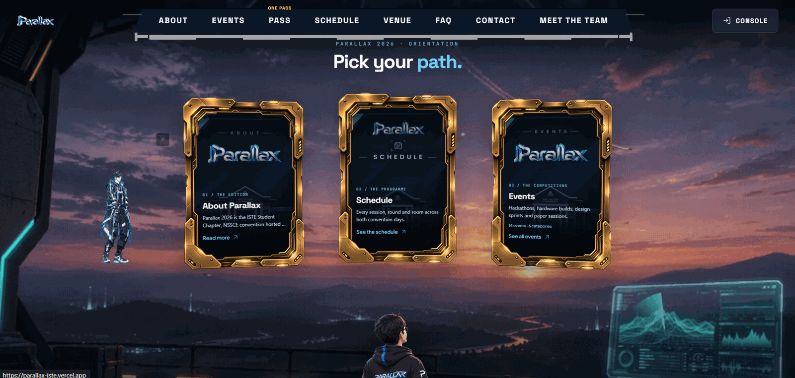
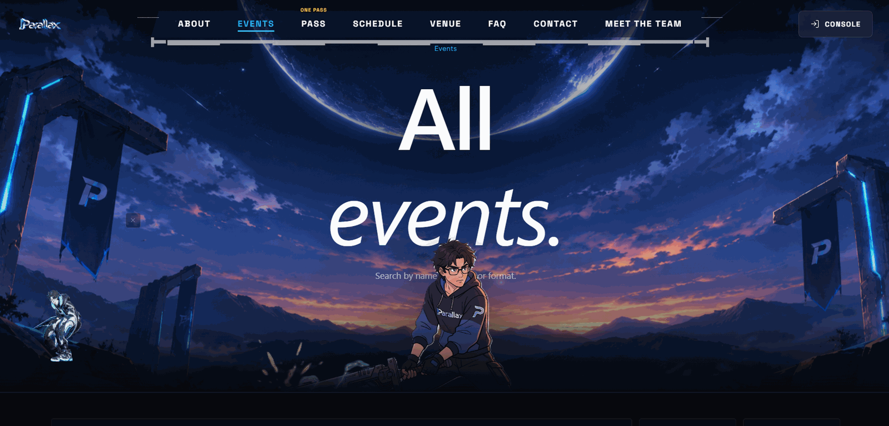
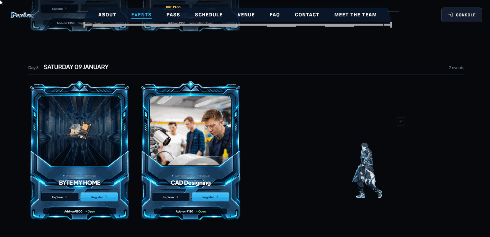

# PARALLAX Convention Web App

PARALLAX is the information and operations web app for the ISTE state student convention hosted by NSS College of Engineering, Palakkad. The repository contains a React single-page frontend, a FastAPI backend, a relational data model, local seed data, supplied brand artwork, and product and deployment documentation.

**Live site:** https://parallax-iste.vercel.app/
---

## Screenshots

<table>
  <tr>
    <td width="50%" align="center">
      <br>
      <b>1. Hero Section & Interactive Guide</b><br>
      <sub>3D lightning parallax hero with navigation HUD and real-time interactive mascot guide.</sub>
    </td>
    <td width="50%" align="center">
      <br>
      <b>2. Holographic Cyber Pedestal</b><br>
      <sub>Volumetric illuminated stage highlighting the 3D Parallax emblem and All-Access Pass overview.</sub>
    </td>
  </tr>
  <tr>
    <td width="50%" align="center">
      <br>
      <b>3. Golden Sci-Fi Navigation Deck</b><br>
      <sub>Tactile metallic cards for About, Schedule, and Events overlooking NSSCE campus hills.</sub>
    </td>
    <td width="50%" align="center">
      <br>
      <b>4. Celestial Events Portal</b><br>
      <sub>Anime engineer protagonist and monolith banners framing the convention event listings.</sub>
    </td>
  </tr>
  <tr>
    <td width="50%" align="center">
      <br>
      <b>5. Cybernetic Event Cards</b><br>
      <sub>Interactive workshop & competition cards (Byte My Home, CAD Designing) with live registration controls.</sub>
    </td>
    <td width="50%" align="center">
      <br>
      <b>6. Panoramic Observation Deck</b><br>
      <sub>Meet the team section featuring sunset vista over Western Ghats and organizing faculty details.</sub>
    </td>
  </tr>
</table>

---

## Table of contents

- [Features](#features)
- [Repository layout](#repository-layout)
- [Run locally](#run-locally)
- [How requests and pages work](#how-requests-and-pages-work)
- [Editing the frontend](#editing-the-frontend)
- [Edition data and policy](#edition-data-and-policy)
- [Payments, verification, and demo behavior](#payments-verification-and-demo-behavior)
- [Deployment and assets](#deployment-and-assets)
- [Documentation index](#documentation-index)

---

## Features

### Public convention site

Public pages read the current edition from the API.

| Route | Description |
|---|---|
| `/` | Introduces the edition, highlights selected events, links to information and sign-in |
| `/about` | Explains the convention, its organizers, and the host |
| `/events` | Event catalogue with search, category, individual/team format, featured-only filtering, and pagination. Cards show category, summary, format, included value, add-on price, availability, and registration state |
| `/events/:eventSlug` | Description, rules, schedule, venue, team size, fees, and registration information |
| `/pass` | Convention pass, included event allowance, cap, add-on charges, and current policy |
| `/schedule` | Schedule days and items from the API |
| `/venue`, `/faq`, `/contact` | Visitor planning information |

The header adapts to a mobile menu, and a footer and not-found page are shared across public routes.

### Participant portal

After sign-in, `/portal` gives an overview and links to participant tools.

| Route | Description |
|---|---|
| `/portal/pass` | Pass status and price, start a pass order, configured payment flow |
| `/portal/select-events` | Choose included events within the selection count and base-value cap (validated by the server) |
| `/portal/registrations` | List registrations; cancel when policy and state allow |
| `/portal/tickets` | Issued tickets with QR codes for entry |
| `/portal/teams` | Create or join a team, manage invite code, leave a team |
| `/portal/verification` | Student verification status and email/document submission |
| `/portal/profile` | View and edit profile details supported by the API |

The portal also shows pass, profile, and verification status, and provides sign-out. Staff accounts can switch between participant and staff views.

### Staff console

Staff routes under `/manage` are guarded in the frontend and authorized again by backend roles and permissions.

| Area | Purpose |
|---|---|
| Overview | Edition and operational summary |
| Events | Create/update events and categories: descriptions, format, schedule, capacity, status, fees, icons |
| Policy | View/update edition policy, inspect validation, control registration settings |
| Registrations | Search and review participant registrations |
| Users | Review users, account status, memberships, staff access actions |
| Verifications | Inspect verification submissions and make decisions |
| Payments | Review payment orders and refunds (when integration and permissions allow) |
| Check-in | Look up or scan tickets and record entry |
| Announcements | Publish, edit, and remove public announcements |
| Attendance | Review check-in and attendance data |
| Audit log | Inspect recorded administrative and operational changes |
| Settings | Review or edit edition-level settings permitted to the staff role |

Roles are permission-scoped, for example super administrator, edition administrator, finance administrator, verifier, event coordinator, and check-in staff. Available actions depend on the role granted by the backend.

### Backend capabilities

The backend in `backend/app/` provides:

- Public edition configuration, current edition, policy, categories, searchable event catalogue, event details, schedule, announcements, public icons, and signed document access.
- Development login and optional Google OAuth, server-side sessions, CSRF protection, optional MFA, session listing and revocation, and role-based access checks.
- Participant profiles, pass orders, included-event selections, add-on registrations, teams, student verification, payment status, tickets, and QR generation.
- Administrative event and policy editing, category and icon management, user and membership administration, verification decisions, payment/refund review, announcements, check-in, attendance, audit records, and settings.
- SQLite for local development, with PostgreSQL/Supabase configured for staging or production. Startup creates tables and seeds demo data in development when enabled.
- Optional Razorpay payments, Google sign-in, Supabase or S3 storage, email, and error monitoring. These need explicit environment configuration; empty example values do not enable them.

---

## Repository layout

```text
.
├── frontend/                 React + Vite application
│   ├── src/
│   │   ├── main.jsx           React entry point and provider composition
│   │   ├── App.jsx            Shared shell, route table, access gates, not-found page
│   │   ├── components/ui.jsx  Reusable buttons, fields, panels, async states
│   │   ├── pages/             Public, portal, staff, and login screens
│   │   ├── style.css          Base styles, visual tokens, breakpoints
│   │   └── theme.css          Additional treatments and page styles
│   ├── images/                Frontend source copies of supplied assets
│   ├── index.html             Browser document shell and metadata
│   ├── package.json           Frontend commands and dependencies
│   └── vite.config.js         Dev proxy, build base, selected asset copying
├── backend/
│   ├── app/api/v1/            Public, auth, profile, participant, admin, webhook APIs
│   ├── app/services/          Business rules: events, passes, teams, payments, etc.
│   ├── app/models/            SQLAlchemy database models
│   ├── app/schemas/           Pydantic API input/output contracts
│   ├── app/core/              Settings, security, permissions, errors, middleware
│   ├── app/integrations/      Storage and email adapters
│   ├── app/seed.py            Idempotent local demo edition and accounts
│   └── tests/                 Backend test suite
├── docs/                     Product, business rules, architecture, deployment notes
├── images/                   Original supplied artwork and logos
├── ss/                       README screenshots (1.png – 6.png)
├── BACKEND.md                Backend setup and API/operations guide
├── DEPLOY.md                 Deployment notes
├── CONTRIBUTING.md           Contribution conventions
├── Dockerfile, render.yaml   Deployment configuration
└── vercel.json               Root hosting configuration
```

---

## Run locally

Run the backend and frontend in separate terminals from the repository root. Python 3.12 is recommended; Node.js and npm are needed for the frontend.

### 1. Start the backend

**Windows (PowerShell):**

```powershell
cd backend
py -3.12 -m venv .venv
.\.venv\Scripts\python.exe -m pip install -e .
.\.venv\Scripts\python.exe -m uvicorn app.main:app --host 127.0.0.1 --port 8000
```

**macOS / Linux:**

```sh
cd backend
python3.12 -m venv .venv
.venv/bin/python -m pip install -e .
.venv/bin/python -m uvicorn app.main:app --host 127.0.0.1 --port 8000
```

For local development the backend generates a development secret if `SERVER_SECRET_KEY` is unset, uses SQLite at `backend/var/parallax.db` by default, creates tables, and seeds demo data on first startup. No `.env` file is required for the default setup. To customize, copy `backend/.env.example` to `backend/.env` and review every value before use. Keep secrets out of version control.

Wait for `Application startup complete`. Useful URLs:

- Health: <http://127.0.0.1:8000/health/live>
- Readiness and database check: <http://127.0.0.1:8000/health/ready>
- Interactive API docs (development): <http://127.0.0.1:8000/api/docs>

**Demo accounts:** `participant@parallax.local` and `owner@parallax.local` (staff). They use no passwords in the local development login flow. Development login is disabled outside development/test and is controlled by `DEV_AUTH_ENABLED` and `ALLOW_DIRECT_LOGIN`. Google OAuth requires valid client credentials.

### 2. Start the frontend

```sh
cd frontend
npm install
npm run dev
```

Vite normally serves the app at <http://localhost:5173>. Its proxy forwards `/api` and `/health` to `http://127.0.0.1:8000`; set `VITE_API_PROXY` if the backend is elsewhere. Frontend and backend origin settings must agree for development session and CSRF checks. The app expects the backend's current edition to load before it renders routes.

### Frontend scripts

```sh
npm run dev          # Vite development server
npm run build        # Production files in frontend/dist/
npm run preview      # Preview the last production build
npm run format       # Format frontend files with Prettier
npm run format:check # Check formatting
npm test             # Node test runner (no frontend tests included yet)
```


## How requests and pages work

1. `frontend/index.html` provides the root document and loads `src/main.jsx`.
2. `main.jsx` mounts React, `BrowserRouter`, and providers for theme, edition/site data, and authentication, and imports both global stylesheets.
3. `App.jsx` picks the page for the current route, loads shared navigation and footer, and applies participant/staff route gates.
4. `pages/Public.jsx`, `Portal.jsx`, `Admin.jsx`, and `Login.jsx` render the visitor, participant, staff, and sign-in interfaces. `components/ui.jsx` supplies shared elements.
5. Pages call shared functions from `src/lib/` (API clients, auth/site/theme providers, date/currency formatters).
6. The backend mounts its routers under `/api/v1`. Public reads live under `/public`; auth, current-user, participant, admin, and webhook endpoints are separated by responsibility.
7. In development Vite proxies API calls to FastAPI. In production the frontend and API are intended to be served from the configured deployment origin.

`App.jsx` also mounts a shared theme customizer on all routes.

**Route table**

- Public: `/`, `/about`, `/events`, `/events/:eventSlug`, `/pass`, `/schedule`, `/venue`, `/faq`, `/contact`
- Auth: `/login`
- Participant: `/portal`, `/portal/pass`, `/portal/select-events`, `/portal/registrations`, `/portal/tickets`, `/portal/teams`, `/portal/verification`, `/portal/profile`
- Staff: `/manage`, `/manage/events`, `/manage/policy`, `/manage/registrations`, `/manage/users`, `/manage/verifications`, `/manage/payments`, `/manage/check-in`, `/manage/announcements`, `/manage/attendance`, `/manage/audit`, `/manage/settings`

---

## Editing the frontend

| Change | Start with |
|---|---|
| Public page content or event catalogue presentation | `frontend/src/pages/Public.jsx` |
| Participant workflow screens | `frontend/src/pages/Portal.jsx` |
| Staff console screens | `frontend/src/pages/Admin.jsx` |
| Sign-in screen | `frontend/src/pages/Login.jsx` |
| URLs, header/footer, route guards, page shell | `frontend/src/App.jsx` |
| Buttons, panels, form fields, empty/loading/error UI | `frontend/src/components/ui.jsx` |
| Colors, typography, spacing, responsive rules | `frontend/src/style.css`, `frontend/src/theme.css` |
| HTML title, metadata, root document | `frontend/index.html` |
| API proxy, base path, static asset copying | `frontend/vite.config.js` |
| Event, policy, account, payment, or registration rules | `backend/app/` services, schemas, and routes |

**Guidelines**

- Use React Router `Link` / `NavLink` for internal navigation.
- Use semantic buttons and labelled form controls; preserve keyboard focus, responsive layouts, and accessible names.
- Reuse existing CSS classes and tokens.
- Keep data access behind the shared API layer once its files are restored.
- Never put secrets in frontend code or `VITE_` variables. Vite embeds them in the browser bundle.

**Edit loop:** start backend and frontend → edit the page/component and CSS → check desktop and narrow mobile layouts → run `npm run build` in `frontend/` (once `src/lib/` is restored).

Server-side rules belong in the backend. UI checks cannot enforce authorization, prices, capacity, or eligibility.

---

## Edition data and policy

The seeded edition slug is `parallax-2026`. Seed data includes categories (Computing, Engineering, Robotics, Electronics, Design) and both individual and team events.

The seed policy sets:

- a ₹350 pass
- a lunch entitlement for both days
- up to three included events, subject to an inclusive ₹450 base-value cap
- a 15-minute hold window
- a selection deadline

These values live in database edition, policy, and event records and may differ after staff changes. **The API is authoritative.** Amounts in API and database logic are integer paise.

An included event's base value counts toward the cap; its add-on price is a separate fee and does not. A convention pass is required independently of event selection. Team registration has size and membership rules. The backend validates event eligibility, selection count and cap, registration state, capacity, pass requirements, team membership, and staff permissions.

Do not hard-code a displayed price or policy in a page when it should come from the current edition API. See [business rules](docs/BUSINESS_RULES.md) and [open decisions](docs/DECISIONS_AND_OPEN_QUESTIONS.md).

---

## Payments, verification, and demo behavior

- **Payments** are disabled by default locally (`PAYMENTS_ENABLED=false`). The API reports when an order uses the mock path and provides a development mock-payment action to exercise pass/registration flows. It never contacts a payment provider or moves money. Real Razorpay processing needs configured credentials and webhook setup. Never use production credentials locally.
- **Verification** can be configured for institution email or document review. Email delivery and remote storage are optional and depend on backend settings. The local demo may use local storage and development-only login.
- Do not treat a seeded account, verification status, payment, or ticket as evidence of real-world eligibility or successful payment.

### Registration profile, lock, pricing, and verification

- Registration is locked until the UTC instant stored in `system_settings` as `registration_unlock_at`. The default is 15 Nov 2026, 00:00 IST. `REGISTRATION_UNLOCK_AT` is only used to seed the setting once; staff can edit it under **Manage → Settings**. The server enforces the lock for all registration and order endpoints.
- Registration prices are centrally stored in `system_settings` in paise: ISTE ₹499, non-ISTE ₹599, Polytechnic ₹299. Polytechnic takes precedence for a Polytechnic ISTE member. Staff can edit the three values under **Manage → Settings**.
- The participant profile collects education level, year, branch, college, membership, accommodation, privacy consent, college ID, and (for ISTE members) membership proof. Branch and college names are normalized and reused. Profile edits are blocked after payment.
- Set `VERIFICATION_MODE=manual`, `api`, or `both`. The API mode currently uses an explicit unsupported ISTE provider adapter stub: no ISTE ID verification provider/API has been confirmed or integrated. `both` records that unavailable result and leaves manual review enabled. Manual verification is under **Manage → Verifications**. Rejections marked fake/invalid request idempotent refunds for paid orders.
- Student documents are private, limited to 5 MB, checked by MIME and file signature, and images are re-encoded. The current retention policy is 365 days. Participants may request account deletion from Profile; staff can fulfill deletion requests in **Manage → Users**.

### Database migrations

The app no longer creates production tables at startup. On a fresh database, run `cd backend` then `uv run python -m alembic upgrade head` before starting the app (use `python -m alembic` rather than the bare `alembic` entry point, which uv cannot launch on Windows). The initial migration creates the complete schema; when applied to the prior `create_all` schema, it adopts existing tables and adds the registration, pricing, profile, and refund-idempotency changes. Back up production before applying schema migrations. Local development still creates tables automatically for convenience.

### Razorpay test checklist

Configure the matching `RAZORPAY_MODE=test`, `RAZORPAY_KEY_ID`, `RAZORPAY_KEY_SECRET`, and `RAZORPAY_WEBHOOK_SECRET`; use test-mode keys only. Set `PAYMENTS_ENABLED=true` only when all keys are present. The frontend receives only the key ID. Razorpay Web Standard Checkout expects the server-created order ID, amount in paise, and INR; only the signed webhook settles payment status.

1. Set an unlock time in the past through **Manage → Settings**, complete the participant profile, and start a pass checkout. Confirm the order amount is the profile rate and the browser gets only a Razorpay order ID/key ID.
2. In test checkout, simulate a success with the Dashboard's test card flow (e.g. domestic Visa `4100 2800 0000 1007`, any future expiry and random CVV) or UPI `success@razorpay`. Confirm the payment becomes paid only after `payment.captured` reaches `/api/v1/webhooks/razorpay`.
3. Use `failure@razorpay` or the Checkout failure control; confirm the order remains unpaid and retry is possible. Close Checkout, then complete a test payment from another device/tab; confirm the webhook still updates the order.
4. Replay the same signed webhook and confirm one payment/registration. Tamper with the body/signature and confirm HTTP 400. Use a tunnel such as ngrok for a local webhook URL, or configure the staging endpoint in Razorpay Dashboard Test Mode; subscribe to `payment.captured`, `payment.failed`, and `refund.processed`.
5. Reject an uploaded proof as fake/invalid, replay the admin action, and verify only one refund request. Confirm the final refund status updates from `refund.processed`.

Test cards and webhook controls are governed by the Razorpay Dashboard and official [integration guide](https://razorpay.com/docs/payments/server-integration/python/integration-steps/) and [webhook testing guide](https://axisbank-docs.razorpay.com/webhooks/test/). This repository has not been connected to merchant test credentials, so the live Checkout and Dashboard steps remain to be run by the deployment owner.

### Admin guide

- **Settings:** change the global registration unlock instant and three registration rates.
- **Verifications:** open the submitted proof and college ID, approve or reject with a reason. To auto-refund, mark the rejection as fake/invalid.
- **Payments:** inspect order/refund state. Pending refunds remain pending until Razorpay confirms them by webhook.
- **Users:** inspect account status. Participants can request deletion; **Fulfill deletion request** deletes their profile and documents and anonymizes account identity while preserving financial audit records.
- **Check-in:** use the camera QR scanner on supported devices, or enter a ticket token manually.

---

## Deployment and assets

`frontend/vite.config.js` uses `VITE_BASE_PATH` for the static asset base, proxies local API requests, and copies selected brand files into the build. Deployment config lives in `frontend/vercel.json`, root `vercel.json`, `render.yaml`, and `Dockerfile`.

Deployment is not automatic from local development. Read [DEPLOY.md](DEPLOY.md) and the relevant hosting guide before publishing or changing base URLs, origins, cookies, storage, or secrets.

Original/supplied visual assets are maintained under `frontend/images/` and runtime assets under `frontend/public/`. Preserve official logos and supplied artwork. See the [asset inventory](docs/assets/image-and-media-inventory.md) and [frontend image notes](frontend/images/README.md).

---

## Documentation index

- [Backend setup, endpoints, data, and security](BACKEND.md)
- [Product overview](docs/PRODUCT_OVERVIEW.md)
- [Frontend architecture notes](docs/FRONTEND_ARCHITECTURE.md)
- [Business rules](docs/BUSINESS_RULES.md)
- [Open decisions](docs/DECISIONS_AND_OPEN_QUESTIONS.md)
- [Configuration guide](docs/CONFIGURATION_GUIDE.md)
- [Asset inventory](docs/assets/image-and-media-inventory.md)
- [Deployment](DEPLOY.md)
- [Contributing](CONTRIBUTING.md)
