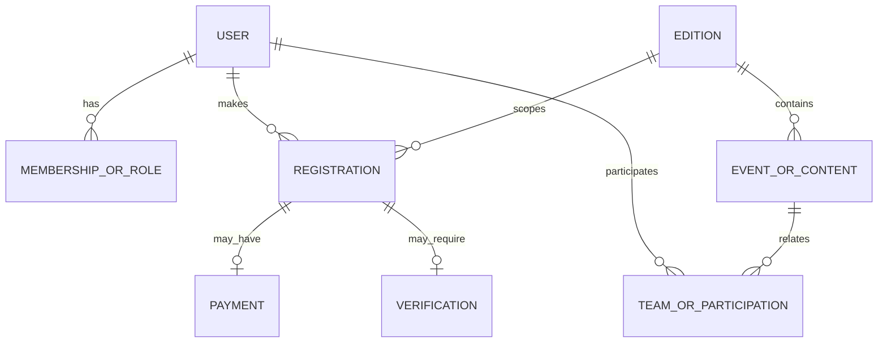

# Database Schema (Conceptual)

This is a conceptual view derived from SQLAlchemy models under `backend/app/models/`. It is intended for orientation, not as a generated migration or complete column-level reference.

## Conceptual ER view

## How to read this diagram

- Entity names are conceptual groupings; exact table/class names and relationships live in `backend/app/models/user.py`, `edition.py`, and `commerce.py`.
- Cardinalities and optionality can vary by feature path (e.g., payment-required vs free/mock flows, verification requirements, team vs individual participation). Verify against models and route behavior before relying on specifics.
- For authoritative schema details, inspect models and migration/runtime configuration used in the target environment.

## Practical guidance

- Treat integer paise as the unit for money-related persisted/payment values where implemented.
- Do not infer production constraints (indexes, uniqueness, nullability, enum values) from this diagram alone; check model definitions and migrations.
- SQLite local fallback and PostgreSQL production behavior may differ in operational characteristics; schema intent should remain consistent with models.
