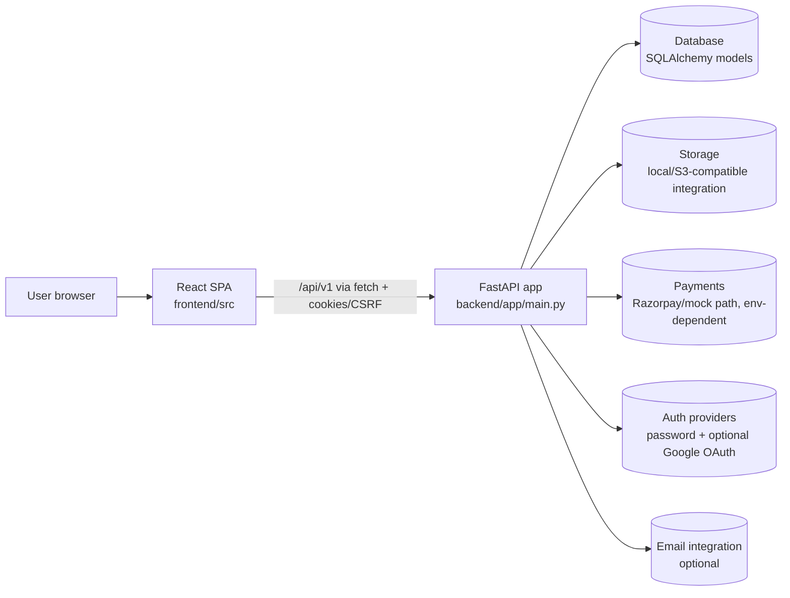

# Architecture Overview

Parallax-website is a full-stack web application with a React SPA frontend and a FastAPI backend.

## High-level view

## How to read this diagram

- The SPA handles routing and UI; the backend owns API behavior, persistence, and integrations.
- Arrows show major runtime boundaries, not every module import.
- Optional integrations (OAuth, payments, storage backend, email) depend on environment configuration and implementation flags; verify before assuming production enablement.

## Components

| Component | Location | Responsibility |
|---|---|---|
| Frontend SPA | `frontend/` | Public pages, participant/admin UI surfaces, client-side routing (`BrowserRouter`), API calls through `frontend/src/lib/api.js`. |
| Backend API | `backend/app/` | FastAPI app factory, `/api/v1` routers, auth/session/CSRF handling, business logic, persistence. |
| Data model | `backend/app/models/` | Users/editions/commerce and related domain records (SQLAlchemy). |
| Integrations | `backend/app/integrations/` | Storage/email and related adapters (implementation-specific). |
| Deployment artifacts | `vercel.json`, `render.yaml`, `Dockerfile`, `api/index.py` | Hosting/build/runtime entrypoints; behavior is environment-specific. |

## Architectural boundaries

- **UI vs API contract:** frontend should consume backend behavior through the API client/HTTP contract, not direct DB access.
- **Business rules:** enforced server-side (registration/payment/verification/admin flows), with UI reflecting server state.
- **Operational state:** live secrets, DNS, webhooks, and deployment health are not fully knowable from repository files.
