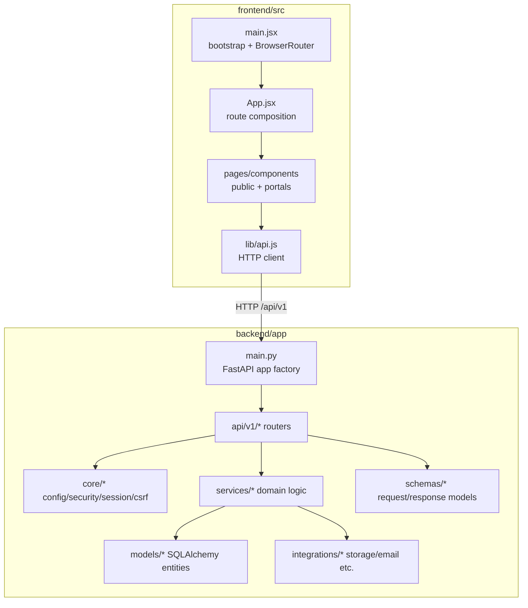

# System Design

This document describes the main runtime modules and responsibilities based on the current repository implementation.

## Runtime modules

## How to read this diagram

- It is a module-level map, not a complete call graph.
- Router handlers in `api/v1` coordinate validation, auth/context, services, and persistence.
- Exact endpoint behavior should be verified in `backend/app/api/v1/*.py` and the frontend calls in `frontend/src/lib/api.js`.

## Key responsibilities

| Area | Responsibility | Primary locations |
|---|---|---|
| SPA bootstrap/routing | Mount app, configure router, define route tree | `frontend/src/main.jsx`, `frontend/src/App.jsx` |
| Frontend API boundary | Send requests, include credentials/CSRF as implemented | `frontend/src/lib/api.js` |
| API composition | Create app, middleware/config wiring, mount `/api/v1` | `backend/app/main.py` |
| Route handling | Public/auth/me/participant/admin/webhooks endpoints | `backend/app/api/v1/*.py` |
| Domain/data | Domain entities and persistence | `backend/app/models/*.py`, DB/session modules |
| Integrations | Optional external capabilities (payments/auth/storage/email) | integration modules + config/env |

## Deployment design notes

- SPA path routing requires host rewrite/fallback to `index.html` (see `vercel.json`/Render notes).
- Serverless vs long-running deployment can affect database/session/storage behavior; treat those details as environment-specific unless verified.
